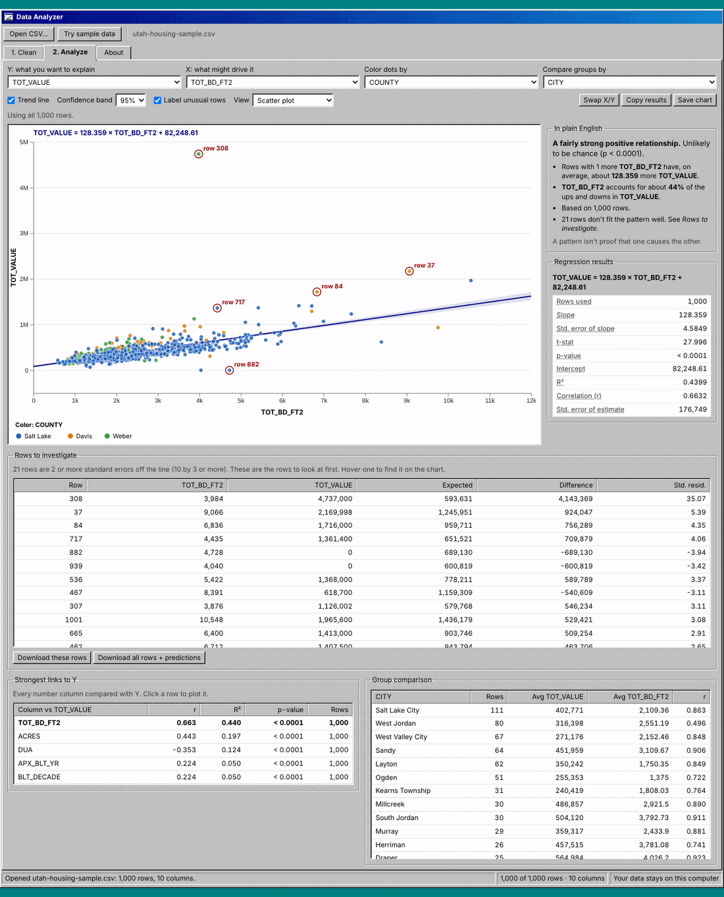

# Data Analyzer

Find out how two columns in a spreadsheet move together, and which rows don't fit the pattern.

Open a CSV file, clean it up, and pick two number columns. Data Analyzer draws the chart, fits a straight trend line, explains the result in plain English, and lists the rows that sit furthest from the line. Everything runs in your browser: your file is never uploaded anywhere.



## What it does

**1. Clean**
- Keep only the columns you need (with a "Suggested" button that skips ID columns, mostly-blank columns and long text)
- Drop rows that have blanks in the columns you mark as required
- Filter rows (equals, contains, greater than, between, before/after a date, and more)
- Allowed ranges for business rules, like "amount above zero"
- Flag or remove unusual values (IQR or top/bottom percent)
- Shrink big files to a random sample (the same sample every time, until you ask for a new one)
- Download the cleaned CSV plus a written log of every step

**2. Analyze**
- Scatter plot with trend line and a 90/95/99% confidence band
- Plain-English summary: how strong the link is, whether it's likely chance, what the slope means
- Full regression output: slope, standard error, t-stat, p-value, intercept, R², correlation, standard error of estimate
- **Rows to investigate:** the rows furthest from the line (studentized residual of ±2 or more, measured against the line the other rows would draw, so one odd month out of five still stands out), with a download
- "Strongest links to Y": ranks every number column against Y; click one to plot it
- Group comparison (averages and correlation per group), color dots by any column
- Residual ("leftovers") view to check whether a straight line fits
- Save the chart as a PNG, copy the results, download every row with its prediction

**About tab:** how to use it, what each number means, and its limits.

## Try it

- **No install:** download this folder and double-click `index.html`. It works offline.
- Click **Try sample data** to load 1,000 Utah homes, or add `?sample` to the address.
- To put it online for free, turn on GitHub Pages for this repo (Settings → Pages → deploy from the `main` branch).

Accepted files: CSV (comma, semicolon, tab or pipe separated). Numbers like `$1,250.00`, `(500)` and Excel's accounting format (` $ (500.00)`, ` $ -  `) are read as numbers; `12%` is read as 12. Decimal commas (`1.234,50`) and Windows-encoded files (Excel's "CSV (Comma delimited)") are detected. Dates are read as YYYY-MM-DD or M/D/YYYY, switching to day/month/year when the file has dates like 31/12/2026. Row numbers match Excel (row 1 is the header). Downloads put an apostrophe in front of text that starts with `=`, `+`, `-` or `@`, so Excel won't run it as a formula.

## Good uses

- **Accounting and audit:** set an expectation (expenses vs. revenue across months or locations) and investigate the items that miss it, the idea behind analytical procedures.
- **Real estate:** how price tracks size, age or lot size; which properties look high or low for their size.
- **Business:** sales vs. ad spend, hours vs. output, cost vs. volume.
- **Data prep:** cut a huge export down to a sample Excel can open, with a log of what changed.

## Limits

One X at a time, straight lines only (simple linear regression). A strong pattern isn't proof of cause and effect. The chart draws at most 5,000 dots so it stays fast, but the math always uses every row. Big files are slower: an 89 MB, 391,845-row file takes about 15 seconds to open and needs roughly 700 MB of browser memory. The size limit is 250 MB.

## How it's built

Plain HTML, CSS and JavaScript, no build step. Charts use [D3](https://d3js.org) (bundled in `vendor/`).

```
index.html                  the page (Clean, Analyze and About tabs)
css/app.css                 Windows 95 look
js/app.js                   loading, cleaning, analysis, chart
js/stats.js                 regression and t-distribution math (no libraries)
vendor/d3.min.js            D3 v7.9.0 (+ its license)
samples/                    sample data (.csv, plus a .js copy so it works offline)
js/parse.js                 reading numbers, dates and file encodings; safe CSV cells
tests/                      math checked against SciPy; number/date reading checks
```

Run the checks with Node 20 or newer (from this folder): `node --test` (11 tests).

When the page runs inside another page (an iframe), it hides its own title bar so it fits in a host window. That's how it appears on [jo-schmo.com](https://jo-schmo.com).

## Credits

Made by Jordan Anderson. It started as a scatter-plot lab in a Master of Accounting analytics class. I rebuilt it into a full tool with help from AI coding tools.

Sample data: [Utah Housing Unit Inventory](https://gis.utah.gov/products/sgid/planning/housing-unit-inventory), State of Utah (SGID). 1,000 randomly chosen single-family homes in Davis, Salt Lake and Weber counties.

## License

MIT (see `LICENSE`). D3 is included under its own ISC license (`vendor/d3-LICENSE.txt`).
